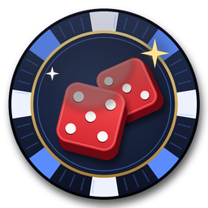

# Roll Casino

Host Hi/Lo gold roll games in **WoW Forever**. Roll Casino announces the round, collects
entries from chat, reads everyone's `/roll`, works out who owes whom, and keeps a full
history with leaderboards you can post to chat.

## How a round works

1. Pick the stakes, the roll:gold ratio and where to broadcast (Say, Party, Raid, Guild or a custom channel).
2. **Start Round**: players type `1` to enter (`-1` to withdraw).
3. **Announce Last Call**, then **Begin Rolling**: everyone does `/roll 1-<stakes × ratio>`.
4. When the last roll lands, the lowest roller owes the highest the difference, posted to chat.

With Say (outside instances) or a custom channel the game only lets addons post after a click,
so the payout waits behind an **Announce Results** button.

## History and leaderboards

Every finished round is stored. Open **History** to see, for *This session*, *Today*,
*Last 7 days*, *Last 30 days* or *All time*:

- a leaderboard: net gold, rounds, wins/losses, best and worst round
- a round log: hover a round for every roll, **Post** it again, or delete it

Post the **Top N**, **Bottom N** or a **Summary** to chat with one click.

## Commands

| Command | |
|---|---|
| `/rc` | Toggle the window |
| `/rc history` | Leaderboard and round log |
| `/rc top [n] [period]` | Post the top *n* winners (period: `session`, `today`, `week`, `month`, `all`) |
| `/rc bottom [n] [period]` | Post the *n* biggest losers |
| `/rc summary [period]` | Post a summary of the period |
| `/rc newsession` | Start a new "This session" |
| `/rc next` / `/rc reset` | Advance / reset the current round |
| `/rc gold <n>` / `/rc ratio <n>` | Stakes in gold / roll:gold ratio |
| `/rc channel <name>` | Custom chat channel |
| `/rc minimap` | Toggle the minimap button |

## Looks

The window uses the NaowhForever house style and follows
its live theme and fonts when NaowhForever is installed; otherwise it uses the Midnight palette.

## License

MIT. See [LICENSE](LICENSE).
